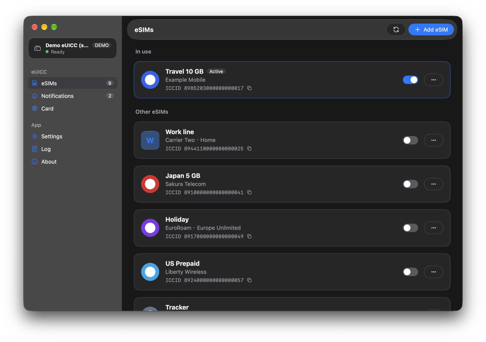
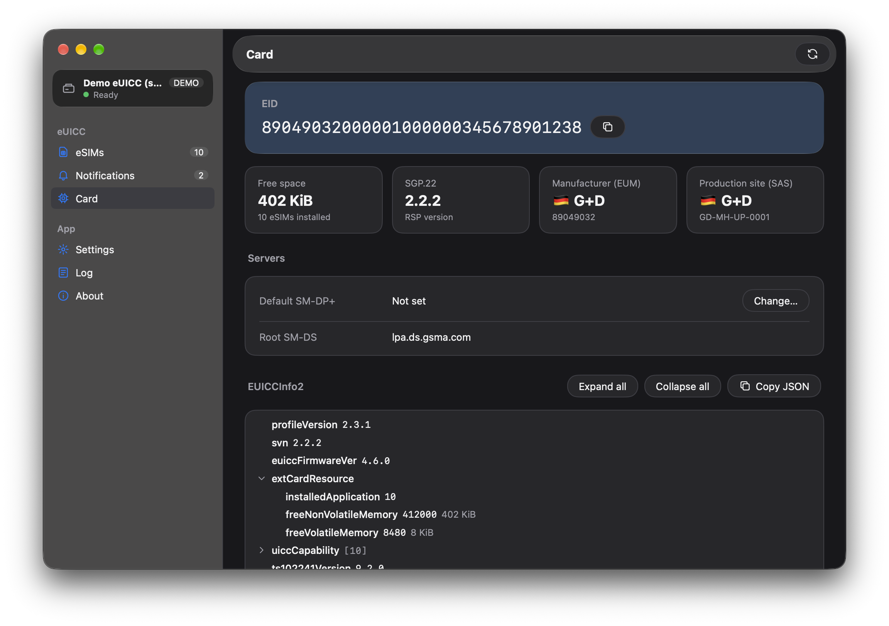

# EasyLPAC
**Language:** [日本語](./README_ja-JP.md) | [正體中文](./README_zh-TW.md)

A GUI LPA for managing eSIMs on removable eUICCs.

> [!IMPORTANT]
> Starting with 0.9.0, EasyLPAC has been rewritten around **libeuicc**, the protocol library of [lpac](https://github.com/estkme-group/lpac), linked into the app. No external `lpac` executable is used or required.
>
> The earlier versions (lpac CLI + Fyne) live on the [`legacy`](https://github.com/creamlike1024/EasyLPAC/tree/legacy) branch, which is no longer maintained.

## Download

[GitHub Release](https://github.com/creamlike1024/EasyLPAC/releases/latest):

# Usage

Connect your card reader or modem, open **Settings**, choose the device, and the card is read.

## Notifications

By default EasyLPAC sends the notification of every operation (install, enable, disable, delete) to the operator's server and removes it once it is sent.

You can turn this off with **Send notifications** in Settings. The pending notifications are then listed on the Notifications page.

Handling notifications by hand does not follow the GSMA specifications, so leaving this on is recommended.

# Screenshots
<p>
<a href="./screenshots/profile.png"></a>
<a href="./screenshots/chipinfo.png"></a>
</p>

# Building from source

Requirements: Go 1.27.3+, [zig](https://ziglang.org/) (used as the C compiler), CMake, and on Linux the pcsc-lite development files (see [Linux](#linux)).

```sh
git clone --recursive https://github.com/creamlike1024/EasyLPAC.git
cd EasyLPAC
./scripts/build-app.sh          # output in build/<os>-<arch>/
```

lpac is a git submodule at `third_party/lpac`. If you cloned without `--recursive`, run `git submodule update --init` first.

## Linux

**Note: The build steps on Linux have not been tested.**

EasyLPAC links the system's pcsc-lite dynamically (`libpcsclite.so.1`); it is never bundled. The app then always talks to `pcscd` through the client library of the same pcsc-lite release, whatever version the build machine had. GTK 3 is loaded at run time and needs no development package.

Build dependencies:

| Distribution | Packages |
|---|---|
| Debian / Ubuntu | `libpcsclite-dev pkg-config cmake` |
| Fedora | `pcsc-lite-devel pkgconf-pkg-config cmake` |
| Arch Linux | `pcsclite pkgconf cmake` |
| openSUSE | `pcsc-lite-devel pkg-config cmake` |

zig does not search the system's library directories, so tell the linker where pcsc-lite is. The binary targets glibc 2.31, while the system's `libpcsclite.so` may have been built against a newer glibc; `--allow-shlib-undefined` accepts that, since the user's own library is the one loaded at run time:

```sh
export CGO_LDFLAGS="-L$(pkg-config --variable=libdir libpcsclite) -Wl,--allow-shlib-undefined"
./scripts/build-app.sh
```

Run-time dependencies: GTK 3, pcsc-lite, and the `pcscd` service with a reader driver (`ccid` for most USB readers):

| Distribution | Packages |
|---|---|
| Debian / Ubuntu | `libgtk-3-0 libpcsclite1 pcscd libccid` |
| Fedora | `gtk3 pcsc-lite pcsc-lite-ccid` |
| Arch Linux | `gtk3 pcsclite ccid` |
| openSUSE | `gtk3 pcsc-lite pcsc-ccid` |

Start the service with `sudo systemctl enable --now pcscd.socket`.

The `.deb` from the release depends on `libpcsclite1` and `pcscd`. Packagers for other distributions should map these to their own packages, and keep pcsc-lite linked dynamically: a statically linked client may speak a protocol version the system's `pcscd` refuses.

# License

- EasyLPAC: [MIT](./LICENSE)
- libeuicc (from lpac), statically linked: [LGPL-2.1-only](https://github.com/estkme-group/lpac/blob/main/euicc/LICENSE). Each release ships `EasyLPAC-source.tar.gz`, the complete source including libeuicc and the scripts that build it, so the library can be modified and the app rebuilt.
- eUICC manufacturer and CI data from the [eUICC Manual](https://euicc-manual.osmocom.org/): CC BY-NC-SA 4.0
