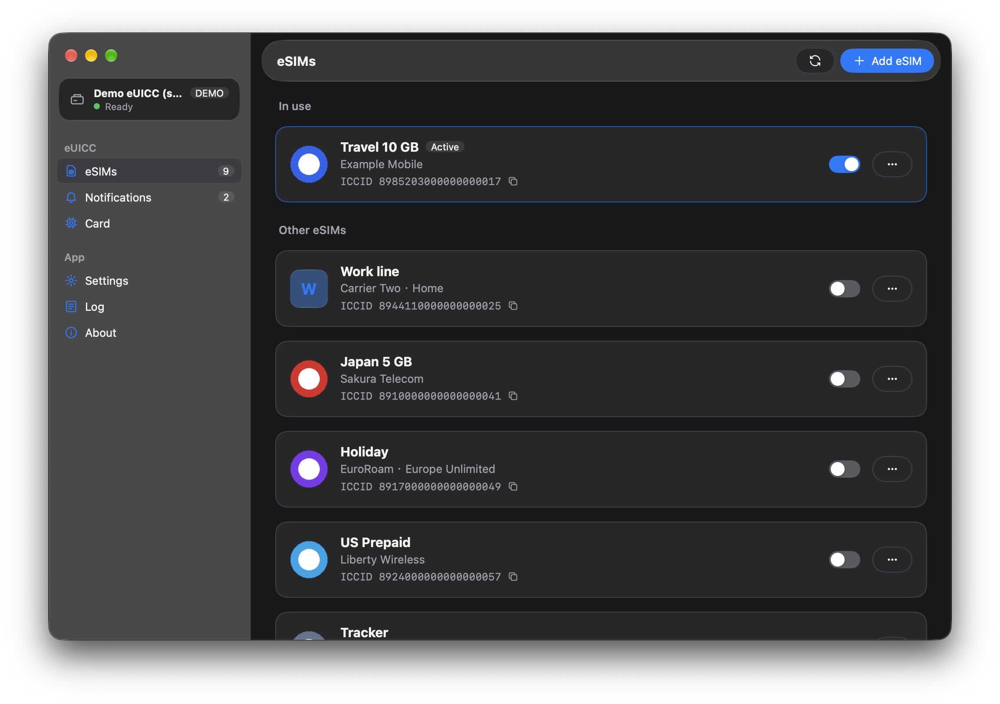
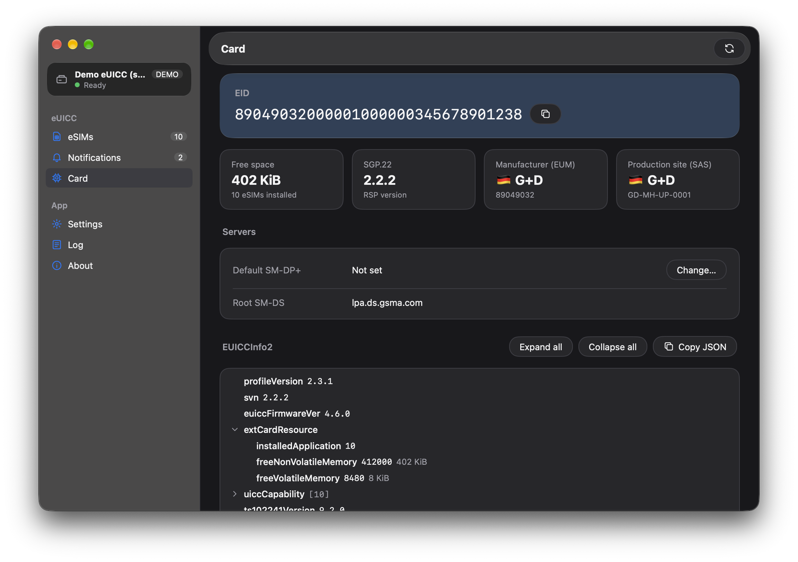

# EasyLPAC
[](https://awesomemygo.dev/apps/easylpac)

**言語:** [English](./README.md) | [正體中文](./README_zh-TW.md)

取り外し可能な eUICC 上の eSIM を管理する GUI の LPA です。

> [!IMPORTANT]
> 0.9.0 以降、EasyLPAC は [lpac](https://github.com/estkme-group/lpac) のプロトコルライブラリである **libeuicc** をアプリに組み込む形で書き直されました。外部の `lpac` 実行ファイルは使用せず、必要もありません。
>
> 以前のバージョン（lpac CLI + Fyne）は [`legacy`](https://github.com/creamlike1024/EasyLPAC/tree/legacy) ブランチに残されており、今後メンテナンスされません。

## ダウンロード

[GitHub Release](https://github.com/creamlike1024/EasyLPAC/releases/latest)

# 使い方

カードリーダーまたはモデムを接続し、「設定」でデバイスを選ぶとチップが読み込まれます。

## 通知

デフォルトでは、EasyLPAC は各操作（インストール、有効化、無効化、削除）の通知を通信事業者のサーバーへ送信し、送信に成功すると削除します。

「設定」の「通知を送信」でこの動作をオフにできます。オフにすると、未処理の通知は「通知」ページに表示されます。

通知を手動で操作することは GSMA の仕様に沿わないため、オンのままにすることをお勧めします。

# スクリーンショット
<p>
<a href="./screenshots/profile.png"></a>
<a href="./screenshots/chipinfo.png"></a>
</p>

# ソースからのビルド

必要なもの：Go 1.27.3 以降、[zig](https://ziglang.org/)（C コンパイラとして使用）、CMake、Linux では pcsc-lite の開発ファイル（[Linux](#linux) を参照）。

```sh
git clone --recursive https://github.com/creamlike1024/EasyLPAC.git
cd EasyLPAC
./scripts/build-app.sh          # 出力先は build/<os>-<arch>/
```

lpac は `third_party/lpac` にある git サブモジュールです。`--recursive` を付けずにクローンした場合は、先に `git submodule update --init` を実行してください。

## Linux

**注意：Linux でのビルド手順は未検証です。**

EasyLPAC はシステムの pcsc-lite（`libpcsclite.so.1`）に動的リンクし、同梱はしません。そのため、ビルド環境のバージョンにかかわらず、アプリは常に同じ pcsc-lite リリースのクライアントライブラリを通じて `pcscd` と通信します。GTK 3 は実行時に読み込まれるため、開発パッケージは不要です。

ビルドに必要なパッケージ：

| ディストリビューション | パッケージ |
|---|---|
| Debian / Ubuntu | `libpcsclite-dev pkg-config cmake` |
| Fedora | `pcsc-lite-devel pkgconf-pkg-config cmake` |
| Arch Linux | `pcsclite pkgconf cmake` |
| openSUSE | `pcsc-lite-devel pkg-config cmake` |

zig はシステムのライブラリディレクトリを検索しないため、pcsc-lite の場所をリンカに指定します。バイナリは glibc 2.31 を対象としていますが、システムの `libpcsclite.so` はより新しい glibc でビルドされている場合があります。実行時に読み込まれるのはユーザー自身のライブラリなので、`--allow-shlib-undefined` でこれを許容します：

```sh
export CGO_LDFLAGS="-L$(pkg-config --variable=libdir libpcsclite) -Wl,--allow-shlib-undefined"
./scripts/build-app.sh
```

実行に必要なもの：GTK 3、pcsc-lite、およびカードリーダードライバ（多くの USB リーダーでは `ccid`）を備えた `pcscd` サービス：

| ディストリビューション | パッケージ |
|---|---|
| Debian / Ubuntu | `libgtk-3-0 libpcsclite1 pcscd libccid` |
| Fedora | `gtk3 pcsc-lite pcsc-lite-ccid` |
| Arch Linux | `gtk3 pcsclite ccid` |
| openSUSE | `gtk3 pcsc-lite pcsc-ccid` |

サービスは `sudo systemctl enable --now pcscd.socket` で起動します。

リリースの `.deb` は `libpcsclite1` と `pcscd` に依存します。他のディストリビューションのパッケージ作成者は、これらを各ディストリビューションのパッケージに置き換え、pcsc-lite は動的リンクのままにしてください。静的リンクしたクライアントは、システムの `pcscd` が受け付けないプロトコルバージョンを使う可能性があります。

# ライセンス

- EasyLPAC：[MIT](./LICENSE)
- libeuicc（lpac 由来、静的リンク）：[LGPL-2.1-only](https://github.com/estkme-group/lpac/blob/main/euicc/LICENSE)。各リリースには libeuicc を含む完全なソースコードとビルドスクリプト `EasyLPAC-source.tar.gz` が付属しており、ライブラリを変更してアプリを再ビルドできます。
- [eUICC Manual](https://euicc-manual.osmocom.org/) の eUICC 製造元および CI データ：CC BY-NC-SA 4.0
