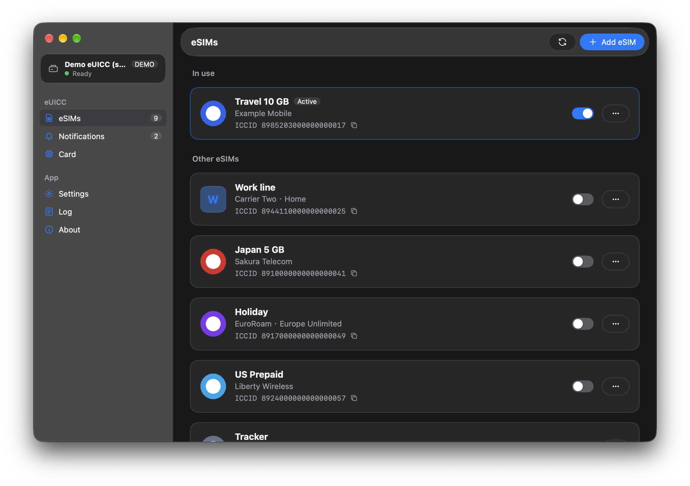
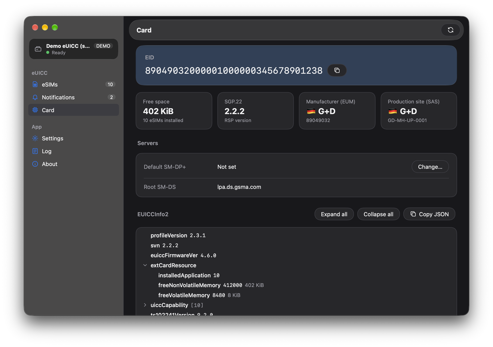

# EasyLPAC
[](https://awesomemygo.dev/apps/easylpac)

**語言:** [English](./README.md) | [日本語](./README_ja-JP.md)

用於管理可插拔 eUICC 上 eSIM 的圖形化 LPA。

> [!IMPORTANT]
> 自 0.9.0 起，EasyLPAC 已改寫為使用 **libeuicc**（[lpac](https://github.com/estkme-group/lpac) 的協定函式庫），並將其連結於程式內，不再使用也不需要外部的 `lpac` 執行檔。
>
> 先前的版本（lpac CLI + Fyne）保留在 [`legacy`](https://github.com/creamlike1024/EasyLPAC/tree/legacy) 分支，已不再維護。

## 下載

[GitHub Release](https://github.com/creamlike1024/EasyLPAC/releases/latest)

# 用法

連接讀卡機或數據機，開啟「設定」，選擇裝置後即會讀取晶片。

## 通知

預設情況下，EasyLPAC 會在每次操作（安裝、啟用、停用、刪除）後將通知傳送至電信業者的伺服器，並在傳送成功後移除。

您可以在「設定」中關閉「傳送通知」。關閉後，待處理的通知會列在「通知」頁。

手動處理通知不符合 GSMA 規範，因此建議保持開啟。

# 截圖
<p>
<a href="./screenshots/profile.png"></a>
<a href="./screenshots/chipinfo.png"></a>
</p>

# 從原始碼建置

需求：Go 1.27.3 以上、[zig](https://ziglang.org/)（作為 C 編譯器）、CMake，Linux 另需 pcsc-lite 開發檔案（見 [Linux](#linux)）。

```sh
git clone --recursive https://github.com/creamlike1024/EasyLPAC.git
cd EasyLPAC
./scripts/build-app.sh          # 輸出於 build/<os>-<arch>/
```

lpac 是位於 `third_party/lpac` 的 git 子模組。若複製時未加 `--recursive`，請先執行 `git submodule update --init`。

## Linux

**注意：Linux 上的建置步驟尚未經過測試。**

EasyLPAC 以動態連結使用系統的 pcsc-lite（`libpcsclite.so.1`），不會將其打包在內。因此無論建置機器上的版本為何，程式一律透過同一個 pcsc-lite 版本的用戶端函式庫與 `pcscd` 通訊。GTK 3 在執行時載入，不需要開發套件。

建置相依套件：

| 發行版 | 套件 |
|---|---|
| Debian / Ubuntu | `libpcsclite-dev pkg-config cmake` |
| Fedora | `pcsc-lite-devel pkgconf-pkg-config cmake` |
| Arch Linux | `pcsclite pkgconf cmake` |
| openSUSE | `pcsc-lite-devel pkg-config cmake` |

zig 不會搜尋系統的函式庫目錄，因此需告訴連結器 pcsc-lite 的位置。執行檔以 glibc 2.31 為目標，而系統的 `libpcsclite.so` 可能以較新的 glibc 建置；由於執行時載入的是使用者自己的函式庫，以 `--allow-shlib-undefined` 允許這種情況：

```sh
export CGO_LDFLAGS="-L$(pkg-config --variable=libdir libpcsclite) -Wl,--allow-shlib-undefined"
./scripts/build-app.sh
```

執行相依套件：GTK 3、pcsc-lite，以及搭配讀卡機驅動程式（多數 USB 讀卡機為 `ccid`）的 `pcscd` 服務：

| 發行版 | 套件 |
|---|---|
| Debian / Ubuntu | `libgtk-3-0 libpcsclite1 pcscd libccid` |
| Fedora | `gtk3 pcsc-lite pcsc-lite-ccid` |
| Arch Linux | `gtk3 pcsclite ccid` |
| openSUSE | `gtk3 pcsc-lite pcsc-ccid` |

以 `sudo systemctl enable --now pcscd.socket` 啟動服務。

發行版本中的 `.deb` 相依於 `libpcsclite1` 與 `pcscd`。其他發行版的打包者應將其對應為各自的套件，並維持以動態連結使用 pcsc-lite：靜態連結的用戶端可能使用系統 `pcscd` 不接受的協定版本。

# 授權

- EasyLPAC：[MIT](./LICENSE)
- libeuicc（來自 lpac，靜態連結）：[LGPL-2.1-only](https://github.com/estkme-group/lpac/blob/main/euicc/LICENSE)。每個發行版本都附有 `EasyLPAC-source.tar.gz`，包含 libeuicc 在內的完整原始碼與建置腳本，可修改函式庫並重新建置程式。
- 來自 [eUICC Manual](https://euicc-manual.osmocom.org/) 的 eUICC 製造商與 CI 資料：CC BY-NC-SA 4.0
