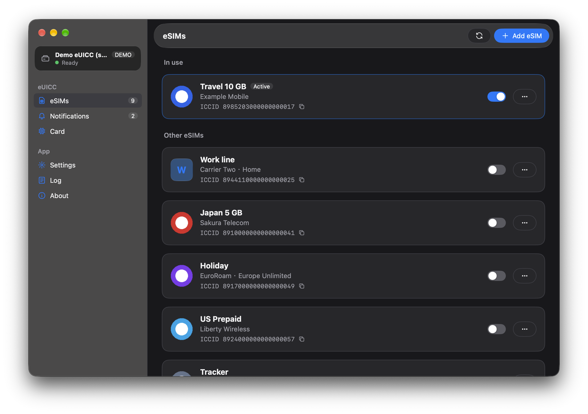
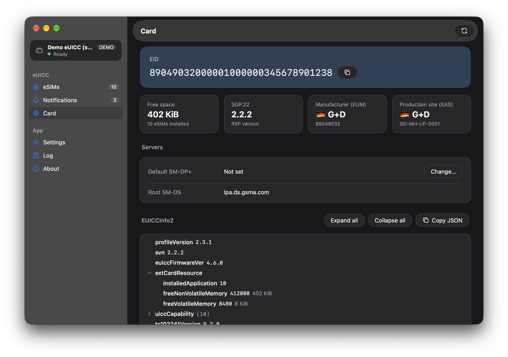

# EasyLPAC
[](https://awesomemygo.dev/apps/easylpac)

**語言:** [English](./README.md) | [日本語](./README_ja-JP.md)

用於管理可插拔 eUICC 上 eSIM 的圖形化 LPA。

> [!IMPORTANT]
> 自 0.9.0 起，EasyLPAC 已改寫為使用 **libeuicc**（[lpac](https://github.com/estkme-group/lpac) 的協定函式庫），並將其連結於程式內，不再使用也不需要外部的 `lpac` 執行檔。
>
> 先前的版本（lpac CLI + Fyne）保留在 [`legacy`](https://github.com/creamlike1024/EasyLPAC/tree/legacy) 分支，已不再維護。

## 下載

[GitHub Release](https://github.com/creamlike1024/EasyLPAC/releases/latest)

# 用法

連接讀卡機或數據機，開啟「設定」，選擇裝置後即會讀取晶片。

## 通知

預設情況下，EasyLPAC 會在每次操作（安裝、啟用、停用、刪除）後將通知傳送至電信業者的伺服器，並在傳送成功後移除。

您可以在「設定」中關閉「傳送通知」。關閉後，待處理的通知會列在「通知」頁。

手動處理通知不符合 GSMA 規範，因此建議保持開啟。

## Android（實驗性）

在 Android 上，EasyLPAC 透過以 OTG 轉接頭連接的 USB 智慧卡讀卡機（CCID）讀取晶片，不經 PC/SC，而是由 [go-ccid](https://github.com/creamlike1024/go-ccid) 直接與讀卡機通訊。系統詢問時，請允許 USB 存取。不支援手機內建的 eSIM 與 SIM 卡槽。

目前僅以一款讀卡機（ACS ACR38U）測試過讀取晶片；在 Android 上安裝與變更 eSIM 尚未測試。

# 截圖
<p>
<a href="./screenshots/profile.png"></a>
<a href="./screenshots/chipinfo.png"></a>
</p>

# 從原始碼建置

需求：Go 1.27.3 以上、[zig](https://ziglang.org/)（作為 C 編譯器）、CMake，Linux 另需 pcsc-lite 開發檔案（見 [Linux](#linux)）。

```sh
git clone --recursive https://github.com/creamlike1024/EasyLPAC.git
cd EasyLPAC
./scripts/build-app.sh          # 輸出於 build/<os>-<arch>/
```

lpac 是位於 `third_party/lpac` 的 git 子模組。若複製時未加 `--recursive`，請先執行 `git submodule update --init`。

## 版本號

`mygo.json` 不記錄實際版本號（內容為 `0.0.0-dev`）：建置腳本會以 `scripts/version.sh` 從 git 標籤取得版本號。在發行標籤上建置即為該版本，如標籤 `v0.9.3` 的 `0.9.3`；在之後的提交上建置則為快照版本，如 `0.9.3.r12.ga4e79e0`（0.9.3 之後第 12 個提交，commit 為 a4e79e0），有未提交的變更時結尾再加上 `.dirty`。對 dpkg、rpm 與 pacman 而言，快照版本都排在其前一個發行版本之後、下一個發行版本之前，因此也可直接作為 Arch Linux `-git` 套件的 `pkgver`：

```sh
pkgver() {
  cd "$srcdir/EasyLPAC"
  ./scripts/version.sh
}
```

需要完整的歷史與標籤：淺複製（`--depth 1`）沒有可供計算的標籤。`EASYLPAC_VERSION=0.9.3 ./scripts/build-app.sh` 可手動指定版本號。

## 發行流程

開發在 `master` 上進行。CI 會測試並建置每次推送與 pull request，並將套件保存為該次執行的 artifact。發行時，在 CI 已通過的 `master` 提交上打 `vx.y.z` 標籤（預發行版本為 `vx.y.z-rc.1`；開頭的 `v` 是 MyGo 自動更新所要求的），並推送該標籤：

```sh
git tag v0.9.3
git push origin v0.9.3
```

該標籤的 CI 會以此版本號建置套件並發布 GitHub Release。舊版本的修正先提交到 `master`，再 cherry-pick 到從該版本標籤建立的 `release/x.y` 分支（`git switch -c release/0.9 v0.9.3`），並在該分支上打標籤。

## Linux

**注意：Linux 上的建置步驟尚未經過測試。**

EasyLPAC 以動態連結使用系統的 pcsc-lite（`libpcsclite.so.1`），不會將其打包在內。因此無論建置機器上的版本為何，程式一律透過同一個 pcsc-lite 版本的用戶端函式庫與 `pcscd` 通訊。GTK 3 在執行時載入，不需要開發套件。

建置相依套件：

| 發行版 | 套件 |
|---|---|
| Debian / Ubuntu | `libpcsclite-dev pkg-config cmake` |
| Fedora | `pcsc-lite-devel pkgconf-pkg-config cmake` |
| Arch Linux | `pcsclite pkgconf cmake` |
| openSUSE | `pcsc-lite-devel pkg-config cmake` |

zig 不會搜尋系統的函式庫目錄，因此需告訴連結器 pcsc-lite 的位置。執行檔以 glibc 2.31 為目標，而系統的 `libpcsclite.so` 可能以較新的 glibc 建置；由於執行時載入的是使用者自己的函式庫，以 `--allow-shlib-undefined` 允許這種情況：

```sh
export CGO_LDFLAGS="-L$(pkg-config --variable=libdir libpcsclite) -Wl,--allow-shlib-undefined"
./scripts/build-app.sh
```

執行相依套件：GTK 3、pcsc-lite，以及搭配讀卡機驅動程式（多數 USB 讀卡機為 `ccid`）的 `pcscd` 服務：

| 發行版 | 套件 |
|---|---|
| Debian / Ubuntu | `libgtk-3-0 libpcsclite1 pcscd libccid` |
| Fedora | `gtk3 pcsc-lite pcsc-lite-ccid` |
| Arch Linux | `gtk3 pcsclite ccid` |
| openSUSE | `gtk3 pcsc-lite pcsc-ccid` |

以 `sudo systemctl enable --now pcscd.socket` 啟動服務。

發行版本提供 `.deb`（相依於 `libpcsclite1` 與 `pcscd`）、`.rpm`（相依於 `libpcsclite.so.1` 與 `pcsc-lite`）及 `PKGBUILD`（相依於 `pcsclite` 與 `ccid`）：將 `PKGBUILD` 與發行版本中的 `.tar.gz` 及兩個圖示（`easylpac-256x256.png`、`easylpac-512x512.png`）放在同一目錄，再執行 `makepkg -si`。其他發行版的打包者應將其對應為各自的套件，並維持以動態連結使用 pcsc-lite：靜態連結的用戶端可能使用系統 `pcscd` 不接受的協定版本。

## Android

除 Go 與 CMake 外，另需 Android SDK（Platform 36、Build-Tools 35.0.0、NDK）與 JDK 17（Gradle 8.14 最高支援 Java 24）。

```sh
./scripts/build-android.sh          # build/android/：APK 與 AAB，arm64
```

未提供上傳金鑰時，發行版以 debug 金鑰簽署。`EASYLPAC_ANDROID_KEYSTORE` 與 `EASYLPAC_ANDROID_KEY_ALIAS` 指定金鑰，`MYGO_ANDROID_KEYSTORE_PASSWORD` 與 `MYGO_ANDROID_KEY_PASSWORD` 提供其密碼。

# 授權

- EasyLPAC：[MIT](./LICENSE)
- libeuicc（來自 lpac，靜態連結）：[LGPL-2.1-only](https://github.com/estkme-group/lpac/blob/main/euicc/LICENSE)。每個發行版本都附有 `EasyLPAC-source.tar.gz`，包含 libeuicc 在內的完整原始碼與建置腳本，可修改函式庫並重新建置程式。
- USB CCID 驅動程式 go-ccid：[MIT](https://github.com/creamlike1024/go-ccid/blob/main/LICENSE)
- 來自 [eUICC Manual](https://euicc-manual.osmocom.org/) 的 eUICC 製造商與 CI 資料：CC BY-NC-SA 4.0
